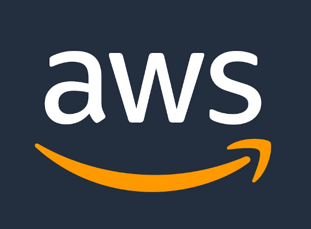
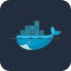

  <h1>Hi 👋, I'm Venkata Guruswami Cheeraboina</h1>

  <!-- ANIMATED ROLES -->
  

  <h3>☁️ Cloud & DevOps Engineer | Infrastructure Automation Specialist</h3>
  
<b>SysAdmin Foundation (3+ Yrs) ➔ AWS Cloud & DevOps Engineering (1+ Yr)</b>

  
<i>Specializing in declarative Infrastructure as Code, CI/CD pipelines, container orchestration, and high-availability enterprise environments.</i>

  

    
    
    
    
  

  

    
    
  

---

### 📋 Professional Overview

* 💼 **Core Experience:** **3+ years** managing Linux/Windows infrastructure, server hardening, and high-availability systems; **1+ year** of AWS cloud and DevOps hands-on work.
* 🛠️ **Infrastructure as Code (IaC):** Terraform provisioning and configuration management with Ansible.
* 🚢 **Containers & Orchestration:** Docker images, Docker Compose, and Kubernetes/EKS concepts (Deployments, StatefulSets, Services, Ingress, RBAC).
* 🔄 **CI/CD & GitOps:** Jenkins, GitLab CI, GitHub Actions, and Argo CD workflows.
* 🛡️ **Observability & Reliability:** Prometheus, Grafana, and AWS CloudWatch.

---

### 🛠️ Technical Competencies & Tooling

  <!-- TECHNOLOGY ICONS: local assets with consistent 60px tile sizes -->
  

    &nbsp;&nbsp;
    &nbsp;&nbsp;
    &nbsp;&nbsp;
    &nbsp;&nbsp;
    &nbsp;&nbsp;
    &nbsp;&nbsp;
    &nbsp;&nbsp;
    &nbsp;&nbsp;
    &nbsp;&nbsp;
    &nbsp;&nbsp;
    &nbsp;&nbsp;
    
  

  <table align="center" width="100%">
    <thead>
      <tr>
        <th align="center" width="30%">Domain</th>
        <th align="center" width="70%">Technologies, Services & Core Capabilities</th>
      </tr>
    </thead>
    <tbody>
      <tr>
        <td align="center"><b>AWS Cloud Services</b></td>
        <td><b>Compute:</b> EC2, Auto Scaling, ECS, Lambda <b>Networking:</b> VPC, Subnets, NAT Gateway, Route 53, ALB/NLB, Security Groups <b>Storage & Database:</b> S3, EBS, EFS, RDS (Multi-AZ), DynamoDB <b>Security & Governance:</b> IAM, KMS, CloudTrail</td>
      </tr>
      <tr>
        <td align="center"><b>Infrastructure as Code</b></td>
        <td><b>Terraform:</b> Modules, Workspaces, Remote State Backends <b>Ansible:</b> Playbooks, Roles, Server Provisioning & Patching</td>
      </tr>
      <tr>
        <td align="center"><b>Containerization & K8s</b></td>
        <td><b>Docker:</b> Multi-Stage Builds, Docker Compose, Image Optimization <b>Kubernetes:</b> Deployments, Ingress Controllers, ConfigMaps, Secrets, HPA</td>
      </tr>
      <tr>
        <td align="center"><b>CI/CD & Automation</b></td>
        <td><b>Pipelines:</b> Jenkins, GitLab CI, GitHub Actions <b>GitOps:</b> Argo CD <b>Scripting:</b> Bash/Shell Scripting, Linux Automation</td>
      </tr>
      <tr>
        <td align="center"><b>Observability & System Admin</b></td>
        <td><b>Monitoring:</b> Prometheus, Grafana, AWS CloudWatch <b>OS Administration:</b> Linux (RHEL, Ubuntu, CentOS), Windows Server, Troubleshooting</td>
      </tr>
    </tbody>
  </table>

---

### 📂 Production-Grade Projects & Implementations

<b>🏗️ Automated Multi-Tier AWS Infrastructure via Terraform</b>

* ⚙️ **Stack:** `Terraform` `AWS VPC` `Auto Scaling` `Application Load Balancer` `RDS Multi-AZ` `S3`
* 📌 **Architecture:** Multi-AZ VPC architecture, security group isolation, auto-scaling EC2 tiers, and database failover design.
* 🔗 **Repository:** [View on GitHub](https://github.com/venkataguruswamich/aws-multi-tier-infra)

<b>🚢 Enterprise Microservices CI/CD Pipeline & Kubernetes</b>

* ⚙️ **Stack:** `Jenkins` `Docker` `Kubernetes (EKS)` `Bash` `Git`
* 📌 **Architecture:** CI pipelines with Docker builds, security scans, and rolling updates to Kubernetes clusters.
* 🔗 **Repository:** [View on GitHub](https://github.com/venkataguruswamich)

<b>🔄 GitOps Continuous Delivery with Argo CD</b>

* ⚙️ **Stack:** `Argo CD` `Kubernetes` `Helm` `GitHub`
* 📌 **Architecture:** Declarative GitOps workflows, synchronization, and drift detection.
* 🔗 **Repository:** [View on GitHub](https://github.com/venkataguruswamich)

---

### 📊 GitHub Activity & Metrics

  
  

---

  <b>Let's build reliable, automated systems together.</b> 
  Open for full-time Cloud & DevOps opportunities.

